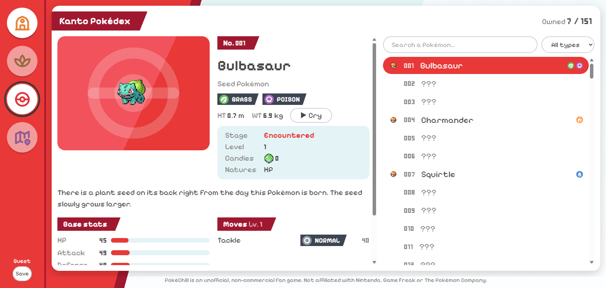
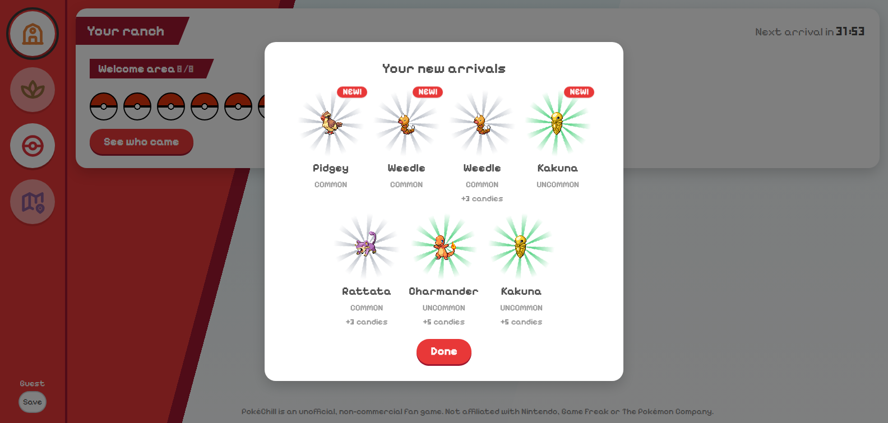

# PokéChill

[](https://github.com/BradSavary/pokechill/actions/workflows/ci.yml)

Un jeu web idle + roguelike dans la région de Kanto. Vous reprenez une pension Pokémon abandonnée : chaque heure, un Pokémon sauvage s'y présente, attiré par ce que vous avez construit, ce que vous avez mis dans la mangeoire, l'heure qu'il est et les Pokémon qui vivent déjà chez vous. L'objectif est de compléter le Pokédex de recherche des 151 espèces, dans l'esprit de *Légendes Pokémon : Arceus*.

**En ligne : [pokechill.bradsavary.dev](https://pokechill.bradsavary.dev)**





Ce qu'on peut faire aujourd'hui : jouer sans compte, découvrir à chaque retour les Pokémon arrivés pendant l'absence (une arrivée par heure, avec une révélation animée), remplir son Pokédex personnel, gagner des bonbons avec les doublons, puis sauvegarder sa partie en créant un compte.

> Projet personnel d'apprentissage de Python et Django, réalisé pour mon portfolio.
> Fan-game non officiel et non commercial. Non affilié à Nintendo, Game Freak ou The Pokémon Company.

## Avancement

Le jeu se construit en 8 étapes jouables, chacune déployée en ligne (conception complète dans [docs/concept.md](docs/concept.md)).

| Étape | Contenu | État |
| --- | --- | --- |
| 0 | Le socle : Django sur Vercel, import PokéAPI, Pokédex consultable | Terminée |
| 1 | Les arrivées horaires, le mode invité et les comptes | Terminée |
| 2 | Les zones de récolte et la mangeoire | Terminée |
| 3 | La recherche : défis, arbre de compétences, maîtrise | Prochaine |
| 4 | Les quêtes quotidiennes et hebdomadaires | Prévue |
| 5 | Le contenu complet de la pension (8 zones, CT, natures, shiny) | Prévue |
| 6 | Les expéditions roguelike (2D, Phaser) | Prévue |
| 7 | Les légendaires et les donjons en 3D (Three.js) | Prévue |

## Stack technique

- **Back-end :** Python 3.13, Django 5.2 (LTS)
- **Moteur de jeu :** Python pur, sans Django (package `game/`), testé avec pytest
- **Front-end :** templates Django, [HTMX](https://htmx.org) pour les mises à jour partielles de page, Tailwind CSS v4
- **Base de données :** SQLite en local, PostgreSQL ([Neon](https://neon.tech)) en production, choisie selon `DATABASE_URL`
- **Hébergement :** Vercel (fonctions Python serverless, fichiers statiques sur le CDN)
- **Outillage :** [uv](https://docs.astral.sh/uv/) (Python et dépendances), Ruff (lint et formatage), pytest, GitHub Actions

## Points techniques

- **Un moteur de jeu en Python pur.** Les règles (horloge, conditions d'arrivée, tirage pondéré par la rareté, conversion des doublons) vivent dans `game/`, sans aucun import Django : une vue charge l'état, appelle une fonction pure, puis enregistre le résultat. Un test fait échouer la CI si cette règle est enfreinte.
- **Un temps de jeu rattrapé à la visite.** Aucun processus ne tourne en permanence (serverless) : à chaque visite, les heures écoulées sont rejouées dans l'ordre, chacune avec une graine aléatoire tirée du joueur et de l'heure. Le résultat est donc identique quel que soit le moment du calcul, ce que vérifient les tests. Un verrou de ligne et une contrainte d'unicité empêchent les doublons si deux onglets se rechargent en même temps.
- **Des espèces pilotées par les données.** Chaque espèce disponible est un fichier JSON (rareté, niveau, arbre de conditions ET/OU), validé strictement et rechargé à chaque déploiement : ajouter une espèce ne demande aucun code.
- **Mode invité.** On joue sans compte : un utilisateur sans mot de passe utilisable est créé à la première visite, puis converti sur place à l'inscription, ce qui conserve toute la partie.
- **Import des données en une fois.** Une commande Django (`import_pokeapi`) récupère espèces, types, attaques et listes d'attaques de Rouge Feu/Vert Feuille depuis [PokéAPI](https://pokeapi.co). Les réponses sont mises en cache sur disque, l'analyse est faite par des fonctions pures, et tout est écrit dans une seule transaction : un import qui échoue ne laisse jamais de données à moitié écrites. L'import est idempotent : le relancer met les lignes à jour au lieu de les dupliquer.
- **Amélioration progressive avec HTMX.** Chaque fiche du Pokédex a sa propre URL et fonctionne sans JavaScript. Avec HTMX, un clic ne remplace que le panneau de la fiche, et la même vue renvoie soit un fragment, soit la page complète selon l'en-tête `HX-Request`.
- **Vues attentives aux requêtes SQL.** Une page Pokédex complète coûte 5 requêtes et une fiche 3, quel que soit le nombre d'attaques, grâce à `select_related` et `prefetch_related`.
- **Testé sans réseau.** Le client PokéAPI est injecté : les tests utilisent un faux client ou `httpx.MockTransport`. La CI vérifie le formatage, le lint, les contrôles Django, les migrations manquantes, les tests, et que le CSS commité correspond aux templates.

Pour le détail de l'architecture, des choix et des procédures, voir la [synthèse technique](docs/technique.md).

## Lancer le projet en local

Prérequis : [uv](https://docs.astral.sh/uv/getting-started/installation/) (il installe Python 3.13 tout seul).

```bash
git clone https://github.com/BradSavary/pokechill.git
cd pokechill
uv sync                                             # crée .venv et installe les dépendances
uv run python manage.py migrate                     # crée la base SQLite locale
uv run python manage.py import_pokeapi --no-media   # importe les 151 espèces (~2 min la première fois)
uv run python manage.py load_species                # rend disponibles les espèces de data/species/
uv run python manage.py runserver
```

Ouvrez ensuite <http://127.0.0.1:8000> : vous jouez en invité. Les sprites et les cris sont déjà dans le dépôt, d'où l'option `--no-media`.

Commandes utiles :

| Tâche | Commande |
| --- | --- |
| Lancer les tests | `uv run pytest` |
| Formater et vérifier le code | `uv run ruff format .` puis `uv run ruff check .` |
| Recompiler le CSS à chaque modification de template | `uv run python scripts/build_css.py --watch` |
| Compte administrateur (puis aller sur `/admin/`) | `uv run python manage.py createsuperuser` |
| Simuler 10 h d'absence pour voir des arrivées | `uv run python manage.py rewind_clock 10` |

## Structure du projet

```
config/              Réglages Django (lus depuis les variables d'environnement) et URLs racines
pokedex/             App Pokédex : modèles, vues, templates, admin
  pokeapi/           Client PokéAPI (avec cache), parseurs et importeur
  management/        La commande import_pokeapi
templates/           Gabarit de base commun
assets/css/          Source Tailwind, compilée dans static/css/main.css
static/              CSS compilé, HTMX, sprites, cris et icônes de types
scripts/             Script de compilation du CSS
tests/               Suite de tests pytest
docs/                Document de conception du jeu
```

## Crédits

- Données de jeu issues de [PokéAPI](https://pokeapi.co) ; sprites, cris et icônes de types issus des dépôts [PokeAPI/sprites](https://github.com/PokeAPI/sprites) et [PokeAPI/cries](https://github.com/PokeAPI/cries).
- Pokémon ainsi que tous les noms et images associés sont des marques déposées et © de Nintendo, Game Freak et The Pokémon Company. Ce projet n'est ni affilié à ces sociétés ni approuvé par elles.
